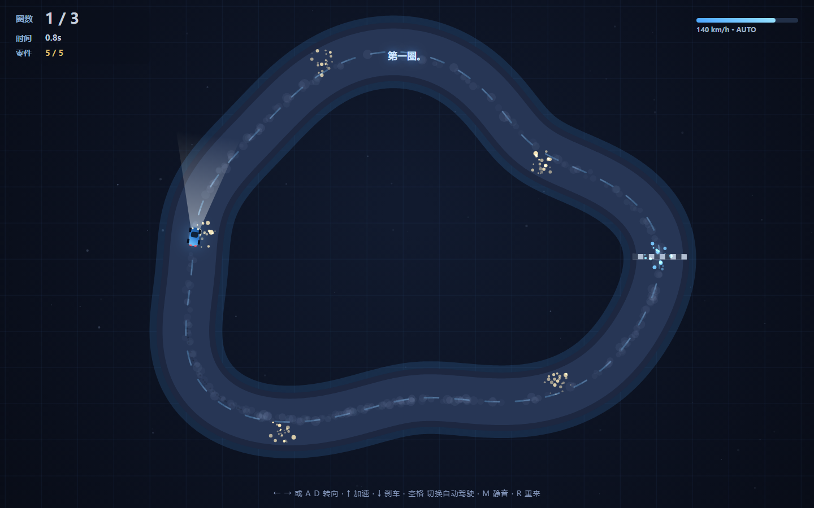
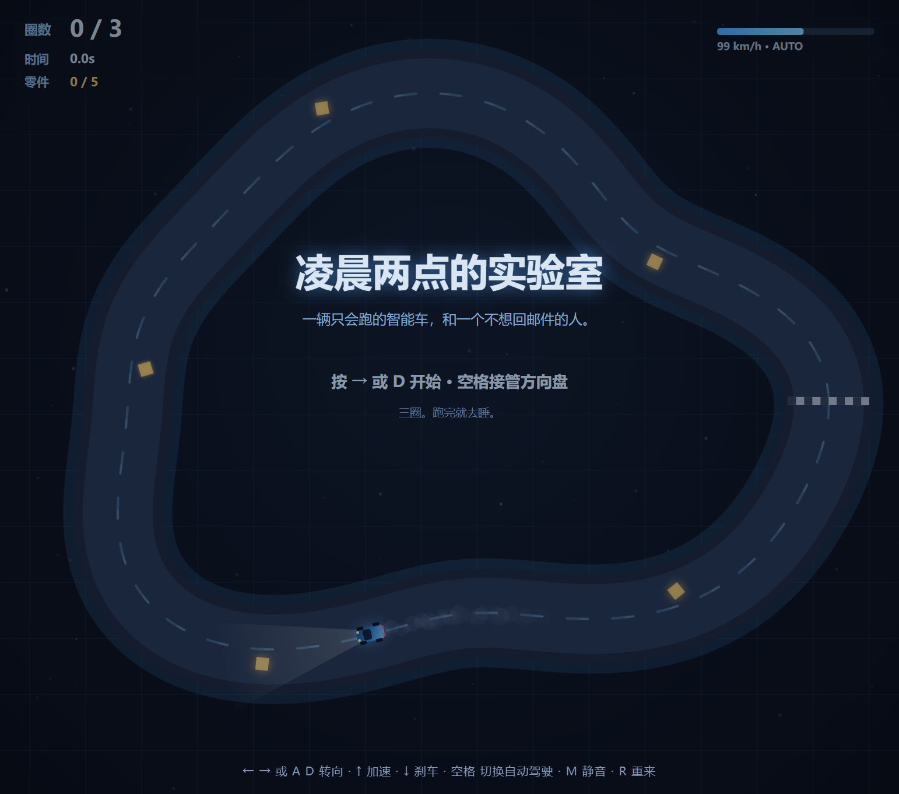

# 凌晨两点的实验室 · At 2 A.M.

**一个不用装任何东西的小游戏。打开就能玩，什么都不用按也能看它跑。**

> 这是一个网页赛车小游戏：深蓝色赛道、一辆只会跑的智能车、三圈、一段结束语。
> 从设计、写代码、调参、测试，到建仓库和上传，**全部由一个 AI 智能体（DeepSeek Harness）独立完成**——
> 人类只提供了一台电脑，和一句「我今天心情并不好」。

## 🎮 在线玩

- **直接开玩**：https://fleet54.github.io/at-2am/ （Pages 生效后即可访问）
- **本地玩**：把仓库下载下来，双击 `index.html`。不需要服务器、不需要构建、不需要联网。

## 怎么玩

| 按键 | 作用 |
| --- | --- |
| `←` `→` 或 `A` `D` | 转向（按一下就从自动驾驶手里接管方向盘） |
| `↑` / `W` | 加速 |
| `↓` / `S` | 刹车 |
| `空格` | 切换自动驾驶（默认就是自动的，你可以什么都不按，看它跑） |
| `M` | 静音 |
| `R` | 重来 |

跑完三圈会有一段话。路上还有五个金色零件，捡齐了车灯会变得很亮。

## 它是什么

- 纯 `canvas` + 原生 JavaScript，**零依赖、零网络请求、不写任何文件、不读任何东西**。
- 声音是 WebAudio 现场合成的（引擎、提示音、完赛），仓库里没有任何音频文件。
- 画面 100% 程序绘制：赛道、车、灯光锥、烟、火花、轮胎痕、网格、星空。
- 尺寸自适应，改窗口大小不会变形。

## 自动驾驶是怎么想的

不是「朝食物（这里没有食物，是朝赛道中线）直着走」那种玩具 AI，而是四层判断：

1. **纯追踪 + PD**：用航向误差与横向误差做 PD 控制（而不是经典纯追踪），并按前方曲率预估松油，避免高速时转弯半径变大冲出赛道；
2. **赛道判定**：闭合抖动椭圆（900 点采样，`w = 1 + 0.13·sin3a + 0.055·cos5a`），用 ±45 采样窗口做局部最近点搜索，找不到就全局兜底；
3. **手动接管**：任何方向键输入都会立刻夺回方向盘，松开之后可以再按空格交还；
4. **可观察**：`window.__game` 暴露了 `state` / `car` / `particles`，浏览器控制台里可以直接改参数看它崩。

调参前后的对比（就是仓库里 `_test_auto.js` 跑出来的）：

| 版本 | 三圈用时 | 出赛道时间占比 |
| --- | --- | --- |
| 初版（纯追踪 + 固定角速度） | 26.7 s | **55.5%** |
| 现版本（PD + 曲率松油） | 29.9 s | **0.0%** |

## 测试

仓库里带两个无头测试，不需要浏览器：

```bash
node _smoke.js        # 伪造 canvas，跑 1400 帧并注入按键，确认不炸
node _test_auto.js    # 全程自动驾驶，断言跑满三圈、出赛道占比 ≤ 15%
```

预期输出：

```
SMOKE OK: 1400 frames, canvas 3200x1800
AUTO OK: 自动驾驶 29.9s 跑完 3 圈，出赛道占比 0.0%
```

还有一个 `_cdp.js`：通过 DevTools 协议连到已经开着的浏览器，读 `window.__game` 的真实状态并截一张现场图（用来验证「不是只在 Node 里能跑」）。

## 截图

| 开场 | 跑圈 |
| --- | --- |
|  |  |

| 结局 | 真实浏览器窗口 |
| --- | --- |
|  |  |

## 文件

- `index.html` —— 外壳（全屏 canvas + 底部按键提示）
- `game.js` —— 全部逻辑：赛道生成、车辆物理、循迹自动驾驶、粒子、音效、HUD、开场与结局
- `_smoke.js` —— 无头冒烟测试
- `_test_auto.js` —— 自动驾驶通关测试
- `_cdp.js` —— DevTools 协议联调 / 截图
- `shots/` —— 截图

## 关于

- **作者**：fleet
- **实现**：DeepSeek Harness（AI 智能体）。没有用任何游戏引擎、没抄任何模板、没有人类手写代码；
  连这个仓库的 README、LICENSE、`git` 提交与 Pages 配置，也是它自己做的。
- **动机**：某个下午有人心情不好，说「做点东西让我开心」。

## License

MIT —— 见 [LICENSE](LICENSE)。随便玩、随便改、随便商用，留个出处就行。
